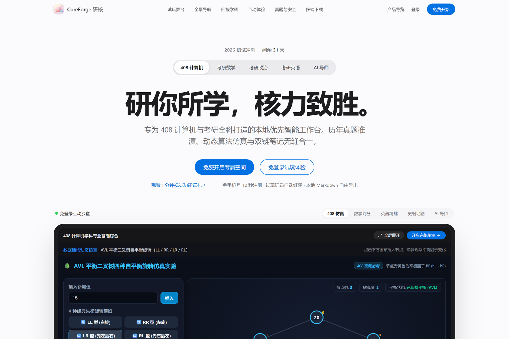
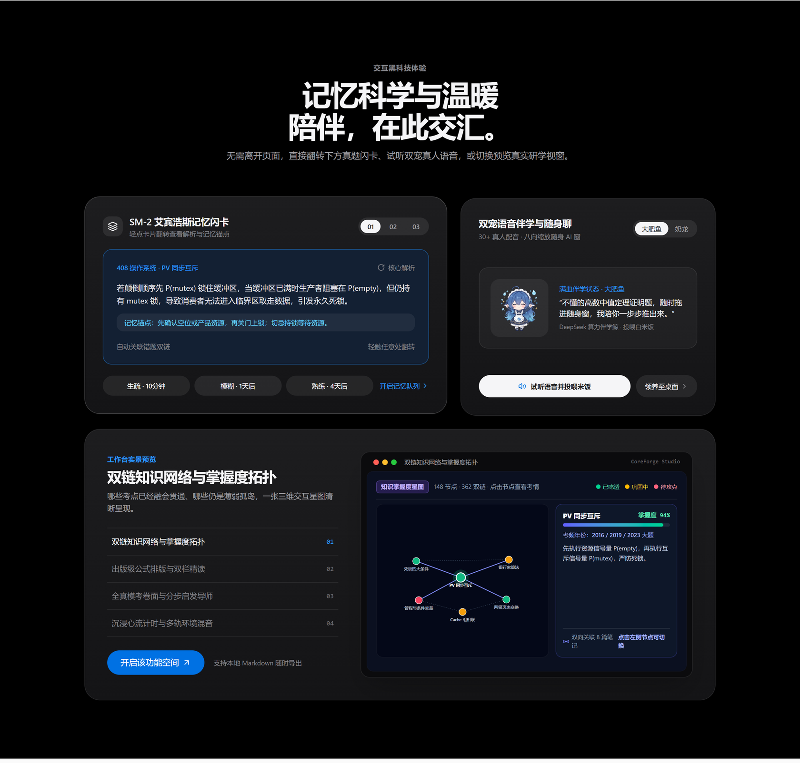
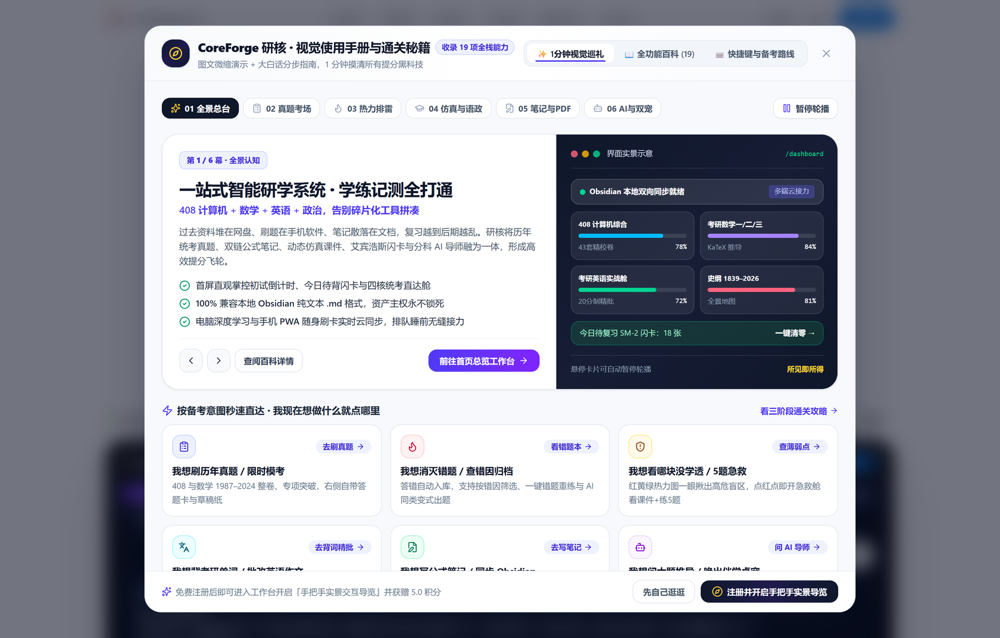
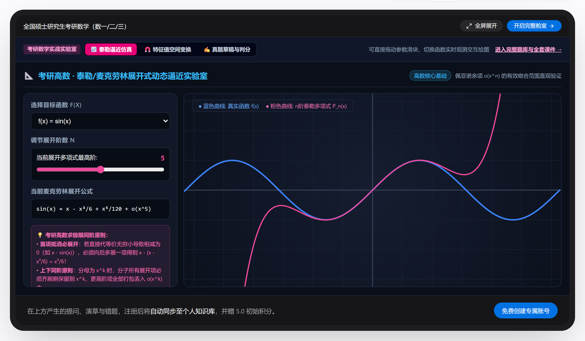
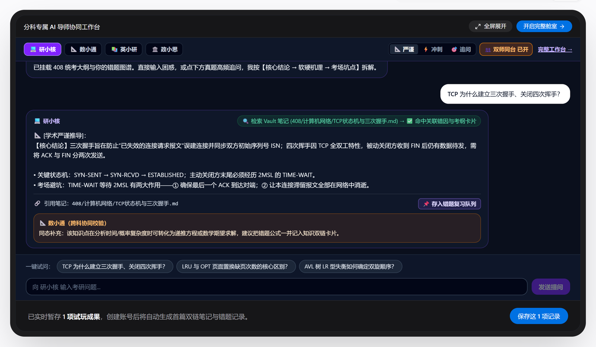
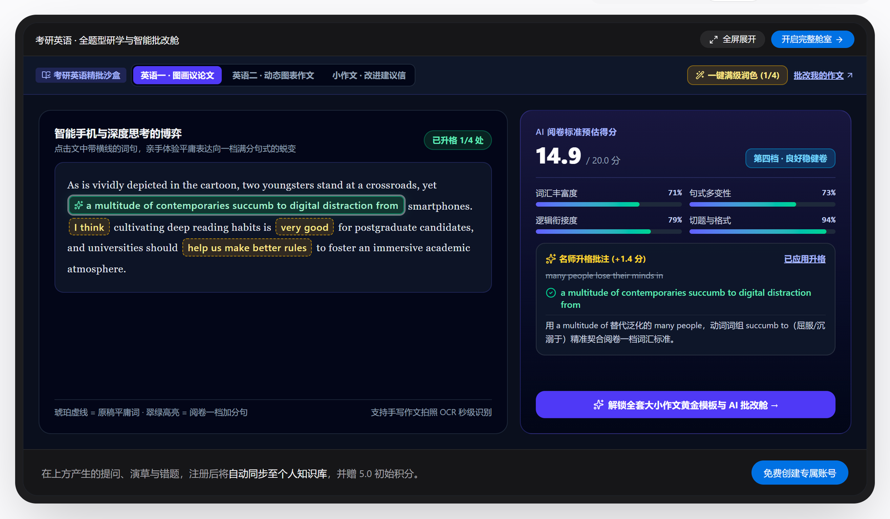
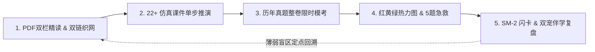
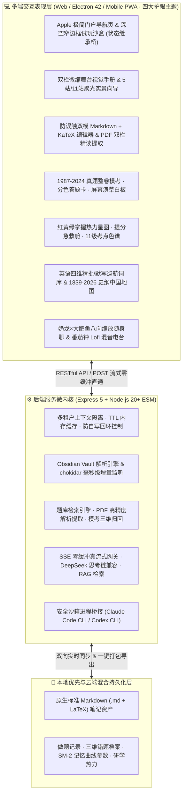

<div align="center">

<a href="https://claudexxb.online">
  
</a>

# ⚡ CoreForge 研核

### 研你所学，核力致胜
**面向 408 计算机与考研数学 / 英语 / 政治的全栈智能研学操作系统 & Obsidian 本地优先知识大脑**

<p align="center">
  <a href="https://claudexxb.online">
    
  </a>
  <a href="https://claudexxb.online/#preview">
    
  </a>
  <a href="https://github.com/qts2218346424-cyber/obsidian-knowledge-viz/releases/latest">
    
  </a>
  <a href="https://qts2218346424-cyber.github.io/obsidian-knowledge-viz/">
    
  </a>
</p>

<p align="center">
  <a href="https://react.dev/"></a>
  <a href="https://www.typescriptlang.org/"></a>
  <a href="https://vite.dev/"></a>
  <a href="https://expressjs.com/"></a>
  <a href="https://www.electronjs.org/"></a>
  <a href="https://katex.org/"></a>
  <a href="https://obsidian.md/"></a>
  <a href="LICENSE"></a>
</p>

<table>
  <tr>
    <td align="center" width="20%">
      <strong>📚 1987–2024</strong><br />
      <sub>统考历年真题精校库</sub>
    </td>
    <td align="center" width="20%">
      <strong>🗺️ 1839–2026</strong><br />
      <sub>史纲全景中国地图</sub>
    </td>
    <td align="center" width="20%">
      <strong>🧪 22+ 实验室</strong><br />
      <sub>单步算法与高数仿真</sub>
    </td>
    <td align="center" width="20%">
      <strong>🤖 4 师 + 双宠</strong><br />
      <sub>思考流答疑与语音伴学</sub>
    </td>
    <td align="center" width="20%">
      <strong>🔓 100% 主权</strong><br />
      <sub>原生 .md 随时无损导出</sub>
    </td>
  </tr>
</table>

[🌐 线上体验官网](https://claudexxb.online) •
[✨ 实机视觉画廊](#-全新极简实机视觉画廊) •
[🔥 痛点破局对比](#-为什么考研人需要-coreforge-研核) •
[🎮 五大免登录实验室](#-零门槛在线试玩五大动态交互实验室) •
[📐 考研四核矩阵](#-四核驱动考研全科深度工具链) •
[🧠 八大智能底座](#-八大智能生产力底座与伴学黑科技) •
[🚀 3分钟私有部署](#-快速开始与本地私有化部署)

---

<a href="https://claudexxb.online">
  
</a>

<p align="center">
  <sub>👆 <strong>v1.5.0 全新极简产品界面实拍</strong> · 点击上方预览图或直接访问 <a href="https://claudexxb.online"><strong>https://claudexxb.online</strong></a> —— 免安装、免注册，即刻在深空窄边框沙盒中体验 408 算法旋转、泰勒多项式拟合、1839–2026 史纲时空轴、英语 20 分制四维精批与分科 AI 导师同台会诊！（试玩记录注册后自动继承）</sub>
</p>

</div>

---

## 💡 开源单机版核心原则：彻底免登、去商业积分、绝对隐私

本项目提供两种形态：面向免安装访客的 **[线上云端体验站 (claudexxb.online)](https://claudexxb.online)**，以及面向广大备考同学的 **开源单机版（本仓库源码 / 桌面端安装包）**。开源单机版专为个人独立研学与私有化知识库打造，坚持三大核心原则：

```
                          CoreForge 研核 · 开源单机纯净架构
        ┌──────────────────────────────────────────────────────────────┐
        │  🔓 彻底免登录      ⚡ 零商业积分限制    🔒 100% 本地隐私主权   │
        │  开箱即用直接进入    无算力点数/无签到    直接读写本机 Obsidian   │
        │  本地管理员全权特权  无充值与兑换码干扰   AI调用直连本地/私有Key │
        └──────────────────────────────┬───────────────────────────────┘
                                       │
                      ┌────────────────┴────────────────┐
                      ▼                                 ▼
             【 🏠 同 Wi-Fi 局域网秒连 】       【 🌍 异地公网免费隧道 】
             手机与电脑连同一 Wi-Fi 直接扫码     自习室/图书馆 4G/5G 扫码即用
             一键放行防火墙 (npm run lan:allow)  一键打通隧道 (npm run remote)
```

| 核心维度 | 💻 开源单机版（本仓库 / Windows 桌面端） | 🌐 线上云端体验站 (claudexxb.online) |
| :--- | :--- | :--- |
| **账号与登录** | **彻底免登录**：启动后直达工作台，无注册、无密码、无强制拦截 | 独立多租户账号体系，支持跨设备同步 |
| **积分与商业化** | **零商业干扰**：彻底移除算力点数、每日签到打卡、充值与兑换码，功能完全免费开放 | 赠送初始算力点数，每日签到领取奖励 |
| **数据隐私** | **100% 落在本地磁盘**：直接读写电脑中的 Obsidian 笔记（`.md`）和本地 SQLite 数据库，**绝不上报或同步到任何云端** | 云端独立沙盒隔离存储 |
| **AI 驱动模型** | 优先调用用户本机 **Ollama / LM Studio / Claude Code / Codex CLI** 或填入私有 Key | 托管云端模型直通网关 |
| **移动端研学** | **电脑作为私有研学服务器**：手机在寝室 Wi-Fi 局域网或自习室 4G/5G 外网扫码即可随时刷题背词 | 手机浏览器直接打开云端网址 |

---

`v1.5.0` 重构了全站视觉秩序：以纯净白瓷 `#FBFBFD`、浅钛灰 `#F5F5F7` 与深空黑 `#000000` 构筑呼吸留白，将十大核心学习空间与记忆陪伴能力熔铸为一触即达的无框 Bento 矩阵：

<a href="https://claudexxb.online/#hub">
  
</a>
<p align="center"><sub><strong>全景工作台导览（<code>#hub</code>）</strong>：非对称 7:5 黑白双旗舰大卡（左：DeepSeek 零缓冲推理链同台会诊 · 右：11 级考点光谱与 PDF 讲义抽卡）搭配八座无框专业舱室</sub></p>

<table>
  <tr>
    <td width="50%" valign="top">
      <a href="https://claudexxb.online/#features">
        
      </a>
      <h4 align="center">🌑 深空黑交互剧场 · 记忆科学与双宠陪伴</h4>
      <p>纯黑沉浸视窗内集成可亲手翻转的 <strong>SM-2 艾宾浩斯真题闪卡</strong>、<strong>大肥鱼 × 奶龙</strong> 真人语音试听舞台，以及 100% 还原工作台实景的三维掌握度拓扑预览。</p>
    </td>
    <td width="50%" valign="top">
      <a href="https://claudexxb.online">
        
      </a>
      <h4 align="center">🧭 1 分钟视觉巡礼手册 · 备考意图秒速直达</h4>
      <p>首创<strong>「左文分步解读 + 右景微缩舞台」</strong>三视图使用手册，内置 6 大高频备考意图罗盘、19 项功能百科检索与 5 站 / 11 站双轨聚光灯实景指路。</p>
    </td>
  </tr>
</table>

---

## 🔥 为什么考研人需要 CoreForge 研核？

备战 **408 计算机综合**、**全国考研数学（数一 / 二 / 三）** 以及 **考研英语、考研政治** 是一场横跨数百天的认知持久战。传统“碎片化工具东拼西凑”往往让大量精力耗散在机械搬运中，而 **CoreForge 研核** 给出了全栈一体化的闭环解法：

| 备考核心维度 | ❌ 传统碎片化工具拼凑 | ⚡ CoreForge 研核（一体化智能研学系统） |
| :--- | :--- | :--- |
| **题库与笔记联动** | 刷题在手机软件、讲义在网盘、笔记在编辑器，复盘错题找不到原定理上下文 | **真题·PDF·双链笔记原生贯通**：左看高清 PDF 原卷讲义、右记双链公式笔记，错题一键沉淀入库并回溯知识源头 |
| **主观大题与作文** | 仅支持客观选择题判对错，高数证明、408 算法设计与英语大小作文难以自评踩分 | **分步拆解导师 + 20分制四维精批**：大题按阅卷踩分点逐级启发引导，英语作文约 **1.2 秒四维打分**与平庸词高阶升格 |
| **抽象机理与盲区** | 平衡树双旋、两级页表转换、泰勒余项全靠静态图文死背；后期陷入“假努力”看不清盲区 | **22+ 动态仿真课件 + 红黄绿热力急救舱**：亲手单步推演算法指针，三色星图定位闪烁红点，**5 题靶向突击**当场救绿 |
| **背词与史纲抗遗忘** | 单词只混眼熟一写就拼错；近代史会议地点与时政定性反复混淆，从头重背耗时极长 | **默写巡航背词 + 1839–2026 史纲地图 + SM-2**：拼写默写与耳机随身连播双管齐下，中国地图同城史实循环联动，遗忘临界点智能推卡 |
| **知识资产与陪伴** | 笔记锁死在封闭云端私有格式中，断网不可用；独自备考几百天枯燥压抑易焦虑 | **本地优先主权 + 双宠温情伴学**：100% 兼容本机 Obsidian `.md` 实时双向同步，**奶龙 × 大肥鱼** 30+ 条真人语音陪你沉浸冲刺 |

---

## 🎮 零门槛在线试玩：五大动态交互实验室

无需下载客户端、无需注册登录，打开 **[claudexxb.online/#preview](https://claudexxb.online/#preview)** 即可在浏览器沙盒中直接交互推演（支持一键切全屏，且试玩足迹注册后自动同步至个人空间）：

<table>
  <tr>
    <td width="50%" valign="top">
      <a href="https://claudexxb.online/#preview">
        
      </a>
      <h4 align="center">💻 实验室 01 · 408 数据结构 AVL 旋转仿真</h4>
      <p>实时交互演示 <strong>LL / RR / LR / RL 四种失衡自平衡旋转</strong>，左侧同步高亮 C 语言核心指针变换代码与平衡因子（BF）追踪日志，彻底攻克 408 树结构高频大题。</p>
      <p align="center"><a href="https://claudexxb.online/#preview">👉 在线动手插入节点试玩 →</a></p>
    </td>
    <td width="50%" valign="top">
      <a href="https://claudexxb.online/#preview">
        
      </a>
      <h4 align="center">📐 实验室 02 · 考研数学泰勒逼近与草稿判分</h4>
      <p>自由拖动展开阶数滑块、切换目标函数，直观观测多项式曲线对真实函数的拟合过程与皮亚诺余项收敛域，秒懂求极限<strong>“首项抵消必展开、上下同阶”</strong>黄金准则。</p>
      <p align="center"><a href="https://claudexxb.online/#preview">👉 在线拖动滑块观测拟合 →</a></p>
    </td>
  </tr>
  <tr>
    <td width="50%" valign="top">
      <a href="https://claudexxb.online/#preview">
        
      </a>
      <h4 align="center">🏛️ 实验室 03 · 1839–2026 史纲全景时空地图</h4>
      <p>横跨三元里抗英等“史上第一次”至 2026 <strong>“十五五”规划与新质生产力时政热点</strong>，高精度矢量中国地图支持<strong>同城多史实循环联动</strong>、重要纲领横向对比与易混项排雷。</p>
      <p align="center"><a href="https://claudexxb.online/#preview">👉 在线漫游百年史纲时空 →</a></p>
    </td>
    <td width="50%" valign="top">
      <a href="https://claudexxb.online/#preview">
        
      </a>
      <h4 align="center">🤖 实验室 04 · 分科 AI 导师思考流（双师会诊）</h4>
      <p>内置 <strong>💻研小核、📐数小通、📚英小研、🏛️政小思</strong> 四位分科名师，支持 DeepSeek 深度思考链零缓冲流式直出、<strong>严谨推导 / 考前冲刺 / 苏格拉底追问</strong>三模切换与双师同台研讨。</p>
      <p align="center"><a href="https://claudexxb.online/#preview">👉 在线向专属导师提问 →</a></p>
    </td>
  </tr>
  <tr>
    <td colspan="2" valign="top">
      <a href="https://claudexxb.online/#preview">
        
      </a>
      <h4 align="center">📚 实验室 05 · 考研英语 20 分制 AI 四维作文精批 & 点词升格沙盒</h4>
      <p align="center">涵盖英一图画议论文、英二动态图表与小作文书信三大黄金模板，轻点文中平庸词句即刻完成<strong>阅卷一档学术表达升格</strong>，实时呈现词汇丰富度、句式多变性、逻辑衔接度与切题格式四维评分报告！ 👉 <a href="https://claudexxb.online/#preview"><strong>立即前往沙盒亲手点词升格 →</strong></a></p>
    </td>
  </tr>
</table>

---

## 📐 四核驱动：考研全科深度工具链

### 1. 💻 408 计算机学科专业基础综合
- **2009–2024 统考真题整卷精校库**：内置 180 分钟全真考场计时器、分色答题卡矩阵、屏幕演草白板与按步给分深度解析。
- **四门专业课核心机理全可视化突破**：
  - **数据结构**：AVL 树 / 红黑树动态旋转、KMP 模式匹配 `next` 数组推演、Dijkstra 最短路径与排序算法沙盒。
  - **计算机组成原理**：IEEE 754 浮点数位级编码、存储器容量的字位扩展、Cache 组相联映射、五段流水线数据/控制冒险。
  - **操作系统**：PV 信号量同步互斥模型、银行家算法安全性序列检查、两级页表虚实地址转换、LRU / OPT / CLOCK 页面置换对比。
  - **计算机网络**：CSMA/CD 争用期碰撞检测、TCP 三次握手与四次挥手状态机、慢开始与拥塞避免滑动窗口推演。

### 2. 📐 全国考研数学（数一 / 数二 / 数三）
- **1987–2024 历年全真统考卷 + 名师冲刺密押**：完整收录 38 年统考卷及李林 6 套卷、经典 1993 特训卷、线代与概率急救专题。
- **大题分步拆解导师 (Step Tutor)**：针对中值定理辅助函数构造、多元极值、二重积分极坐标转换、特征值正交对角化等核心大题，按阅卷踩分点逐步点拨。
- **出版级 KaTeX 数学排版**：复杂分块矩阵、分段函数、多重积分与极限推导毫秒级丝滑渲染，支持 `Σ` 菜单一键速插公式模板。

### 3. 📚 考研英语全题型研学与全新背词中枢（英一 / 英二）
- **历年整卷沉浸精读 & 点词即查**：覆盖完形填空、传统阅读、新题型（七选五 / 排序 / 小标题）与英译汉，正文任意生词单击即弹音标、考纲义项与真题例句浮窗。
- **全新四维背词系统**：集齐 **拼写默写防笔误**、**耳机随身巡航自动连播（走路排队解放双手）**、**靶向高频词单**、**一键转存 SM-2 闪卡** 以及 **Level 50→950 五阶词汇色谱与词根衍生族谱**。
- **20 分制 AI 作文精批 & 每日同源外刊**：秒级四维阅卷批改与词汇句型升格，搭配《经济学人》等同源外刊长难句语法树拆解。

### 4. 🏛️ 考研政治百炼中枢（1839–2026 全景升级）
- **全屏矢量中国历史地图**：将 1839 虎门销烟/三元里抗英至 2026 新时代重大事件精准落点于地理空间，支持**同城多史实循环切换**（如上海、瑞金、遵义、延安、北京历次重大会议一键串联对比）。
- **“史上第一次”专题 & 十五五时政热点**：系统梳理近代以来高频必考“第一次”定性锚点，同步更新 **2024–2026 大思政与“十五五”规划、新质生产力**核心命题点。
- **五大模块千题即刷即改 & 遮罩背诵卡**：覆盖马原、毛中特、新思想、史纲、思修法基，提供混淆项深度排雷与主观题框架遮罩刮卡自测。

---

## 🧠 八大智能生产力底座与伴学黑科技

- **🔥 红黄绿掌握热力星图 & 提分急救舱**：根据做题对错率与闪卡反馈动态着色全考纲节点；单击闪烁红灯盲区即刻弹出**提分急救舱**，一条龙完成「复盘历史错题 → 调取配套动画课件 → 实测 5 道靶向真题」当场救绿！
- **🎨 11 级考点色谱（灰阶 408 × 紫阶数学）**：将 22 大最具区分度的压舱石枢纽按由浅入深的 11 级色阶排成进阶阶梯，支持自建攻坚目标与一键 **Ask AI 生成自测卷**。
- **📕 智能错题本与三维归因重练**：答错自动入库，按「学科 · 年份 · 考点 · 错因类型（概念混淆 / 计算失误 / 审题不清 / 思维定势）」聚类，支持一键洗牌错题重练与 **AI 同母体变式强化**。
- **🧬 SM-2 艾宾浩斯间隔重复引擎**：从 Markdown 笔记、错题与生词库自动提取问答闪卡，依据每次回忆质量（生疏 / 模糊 / 掌握）动态排期，每日清晨推送遗忘临界点卡片。
- **📄 PDF 双栏高清精读器 & 智能题卡提取**：完备支持 CJK 中文字体渲染，左看原版电子教材/真题卷并荧光笔圈注，右写双链推导笔记，支持**一键从 PDF 智能识别提取题库与闪卡**。
- **✍️ 防误触双模知识大脑 & Obsidian 实时同步**：已有笔记默认优先进入印刷级预览防手滑；写作态支持**富文本直观打字与源码互切**、多级目录创建、`即学即练（现场出 3 题）`，与本机 Obsidian `.md` 目录毫秒级双向同步。
- **🤖 零缓冲思考流 AI 导师 + 本机 CLI 多智能体桥接**：支持透视 DeepSeek 完整破题思考链、鼠标划词追问细节、6 款沉浸式护眼聊天背景，并可通过安全沙箱桥接本机 **Claude Code CLI** 与 **Codex CLI** 批量治库。
- **🐲 奶龙 × 🐟 大肥鱼 双魂桌宠 & 跨页白噪音自习室**：自由切换暖心夸夸「奶龙（喂烤鸡腿🍗）」与傲娇干饭鲸鱼娘「大肥鱼（喂冒尖白米饭🍚补 Token）」，内置 **30+ 条真人趣味配音**及**可自由拖拽、八向缩放的随身聊窗口**；搭配雨声/篝火/Lofi 电台跨页连播、番茄钟及**极简/鲜艳/护眼/暗黑**全站四主题！

<details>
<summary><strong>🧪 点击展开：内置 22+ 动态仿真课件完整目录</strong></summary>
<br />

| 所属学科模块 | 内置可交互单步仿真课件实验室 |
| :--- | :--- |
| **408 · 数据结构** | `AVL 平衡二叉树四种旋转` · `KMP 字符串匹配与 next 数组` · `Dijkstra 单源最短路径推演` |
| **408 · 计算机组成原理** | `IEEE 754 浮点数二进制编码转换` · `存储器字位扩展连线` · `Cache 直接/全相联/组相联映射` · `CPU 五段流水线时空图与冒险` |
| **408 · 操作系统** | `两级页表逻辑地址转换` · `FIFO / OPT / LRU 页面置换算法对比` · `PV 信号量同步互斥经典模型` · `银行家算法死锁避免安全性序列` |
| **408 · 计算机网络** | `CSMA/CD 载波监听与争用期碰撞退避` · `TCP 三次握手与四次挥手状态机` · `TCP 慢开始/拥塞避免/快重传窗口推演` |
| **全国考研数学** | `泰勒与麦克劳林高阶多项式动态逼近` · `旋转体体积微元切片演示` · `二重积分直角坐标转极坐标` · `施密特正交化几何过程` · `矩阵特征值与特征向量空间线性变换` · `二维正态分布三维曲面与边缘分布` |
| **全国考研政治** | `1839–2026 近现代史纲时空编年演进` · `马原唯物辩证法三大规律图解` · `政治经济学剩余价值率与资本有机构成计算` · `经典著作时间线` · `时政专题脉络` |

</details>

<details>
<summary><strong>⌨️ 点击展开：全站效率键盘快捷键速查表</strong></summary>
<br />

| 快捷键组合 | 适用场景 | 核心作用 |
| :--- | :--- | :--- |
| **`Ctrl + K`** (`⌘K`) | 全站任意界面 | 秒开全局极速搜索（检索历年真题、双链笔记或按 `#标签` 过滤） |
| **`Ctrl + Shift + A`** | 全站任意界面 | 随时呼出或收起分科 AI 伴学导师悬浮问答窗 |
| **`Ctrl + J`** (`⌘J`) | 刷题作答界面 | 将当前正在作答的真题题干一键抛给 AI 导师启发拆解 |
| **`←` / `→` / `Enter`** | 刷题练习模式 | 丝滑切换上一题、下一题 / 快速展开或收起本题解析 |
| **`Ctrl + S`** (`⌘S`) | 笔记编辑器 | 立即落盘保存 `.md` 笔记并同步至本地 Obsidian 文件夹 |
| **`Ctrl + B` / `Ctrl + 1,2,3`** | 笔记写作模式 | 选中文本加粗强调 / 一键切换一、二、三级章节标题 |
| **`Ctrl + V`** (`⌘V`) | 笔记写作模式 | 剪贴板截图秒速自动上传并转换为标准图片语法嵌入 |
| **`Esc`** | 弹窗与全屏沙盒 | 快速关闭当前弹出模态框或退出全屏试玩实验室 |

</details>

---

## 📱 全平台多端无缝协同

无论在自习室桌面深度啃书，还是在食堂排队碎片化刷卡，CoreForge 研核均提供最佳载体：

| 平台形态 | 获取与访问方式 | 核心适用场景 |
| :--- | :--- | :--- |
| 🌐 **Web 在线云端旗舰版** | 直接访问 **[https://claudexxb.online](https://claudexxb.online)** | **零安装即开即用**，独立多租户沙盒隔离，跨电脑 / iPad 实时同步做题进度、错题本与双链笔记 |
| 💻 **Windows 桌面独立客户端** | 前往 **[官网下载中心](https://claudexxb.online/#download)** 获取 64 位安装包 | 独立窗口隔绝浏览器娱乐干扰，深度直连本地 Obsidian 目录实时监听，支持本机 CLI 智能体桥接 |
| 📲 **手机随身伴学端 (PWA)** | 手机浏览器访问 **[claudexxb.online](https://claudexxb.online)** 并点「添加到主屏幕」 | 完美适配 Android / HarmonyOS / iOS 单手触控，通勤排队开启背词随身巡航、翻闪卡与刷政治千题 |

---

## 🗓️ 考研三阶段科学通关路线



1. **🌱 基础筑基期（3 月 – 6 月）**：用 **PDF 双栏精读 + 双链笔记** 搭建学科主干树，遇到抽象算法打开 **动态仿真课件** 亲手单步推演，早晚用 **背词随身巡航 + 5阶词根色谱** 扫除大纲生词。
2. **🔥 强化攻坚期（7 月 – 10 月）**：主攻 **刷题中心（题型专项 + 历年真题）**，每周打开 **掌握热力图 & 提分急救舱** 把闪烁红点逐个救绿，结合 **1839–2026 史纲全景地图** 刷透政治千题混淆项。
3. **🚀 冲刺密押期（11 月 – 12 月）**：开启 **180 分钟真题/李林密押整卷考试模式**，使用 **英语 20 分制 AI 四维精批 + 核心写作词拼写默写** 锁死主观题高分，每天 15 分钟清空 **SM-2 到期闪卡**。

---

## 🏗️ 系统分层全景架构



---

## 🚀 快速开始与本地私有化部署

如果你希望在本地连接自己的 Obsidian 知识库运行或进行二次开发，只需 **3 分钟** 即可启动完整全栈工作台：

### 1. 环境要求
- **Node.js**：`v20.0.0` 及以上版本
- **操作系统**：Windows 10/11、macOS 或 Linux

### 2. 克隆仓库与安装依赖
```bash
git clone https://github.com/qts2218346424-cyber/obsidian-knowledge-viz.git
cd obsidian-knowledge-viz
npm install
```

### 3. 一键初始化配置与电脑全自动智能装配 (Auto-Discovery)
```bash
# 【小白一键神器】全盘自动检测本机已有的所有 Obsidian 知识库、本地智能体与插件 AI 密钥并自动完成装配
npm run autoconfig

# 或运行基础环境健康体检
npm run doctor
```

本项目采用 **四级弹性 AI 驱动架构**，无论你的电脑配置如何均可开箱即用：
- **极客满血版（推荐）**：本机已安装并登录 `Claude Code CLI`、`Google Antigravity` 或 `Codex CLI`，系统将自动桥接宿主全权智能体，直接联动你的本地 Obsidian 知识库进行深度伴读与重构。
- **轻量云端兜底**：支持 `.env`（参考 `.env.example`）或在软件【设置】页一键填写 **DeepSeek / 硅基流动 / OpenAI / Anthropic** API Key，无需独立显卡即可极速响应。
- **本地离线推理**：自动探测本机运行中的 **Ollama** (`:11434`) 或 **LM Studio** (`:1234`)，实现 0 Token 费用纯离线答疑。
- **纯离线无 AI 模式**：即使暂不配置任何模型，历年真题库、22+ 交互实验室、SM-2 闪卡与知识图谱仍可 100% 本地离线运行。

> 💡 也可直接在软件界面的 **【设置 → 系统底座 / 环境体检】** 中点击 **「智能探测我的电脑」**，前端即可自动列出电脑上所有知识库，支持一键点击切换绑定！

按需编辑 `server/config.json`（已纳入 `.gitignore` 安全保护，绝不上传泄露密钥）：
```json
{
  "vaultPath": "./sample-vault",
  "port": 3001,
  "host": "127.0.0.1",
  "localAgents": {
    "antigravityCommand": "antigravity",
    "claudeCommand": "claude",
    "codexCommand": "codex",
    "ollamaBaseURL": "http://127.0.0.1:11434",
    "lmStudioBaseURL": "http://127.0.0.1:1234"
  },
  "ai": {
    "provider": "openai",
    "apiFormat": "openai",
    "baseURL": "https://api.deepseek.com/v1",
    "apiKey": "",
    "model": "deepseek-chat"
  }
}
```

### 4. 一键启动前后端工作台
```bash
# 并行启动前端 Vite 热更新服务 (:5173) 与后端 Express 微内核 (:3001)
npm run dev:all
```
打开浏览器访问 **`http://localhost:5173`**（新用户首次进入将自动唤起新版视觉手册与聚光灯实景导览），或直接访问线上官方云端站 **[https://claudexxb.online](https://claudexxb.online)** 即刻开启高效备考！

### 5. 常用工程、环境体检与桌面打包脚本
| 命令 | 功能说明 |
| :--- | :--- |
| `npm run autoconfig` | **(小白装配首选)** 全盘智能扫描本机所有 Obsidian 知识库、本地智能体与插件 AI 密钥并自动完成绑定 |
| `npm run setup` | **(首次复刻推荐)** 一键生成初始配置模板（不覆盖已有配置）并执行本机环境健康体检 |
| `npm run doctor` | 自动诊断本机 Node.js、Obsidian 知识库、Claude Code / Antigravity / Ollama 与云端 API 状态 |
| `npm run dev:all` | **(推荐)** 并行启动前端开发服务器 (`:5173`) 与后端 API 微内核 (`:3001`) |
| `npm run lan:allow` | **(移动端互联)** 一键放行 Windows 防火墙 TCP 3001 端口，解决手机 Wi-Fi 扫码打不开的问题 |
| `npm run remote` | **(异地远程访问)** 一键启动 Cloudflare 免费公网安全隧道，生成专属 HTTPS 访问链接与终端二维码 |
| `npm run build:all` | 执行严格 TypeScript 类型校验并完成前后端生产级构建 |
| `npm run pack` | 基于 Electron Builder 打包生成桌面端独立安装包（输出至 `release/`） |

### 6. 📱 手机 / 平板随时随地跨端研学指南（无需购买服务器）

CoreForge 研核支持以你的电脑为“私有研学服务器”，手机随时连接背单词、刷真题、复习艾宾浩斯闪卡，所有数据完全保存在你的本地电脑中：

- **场景 A：同寝室 / 同 Wi-Fi 局域网秒连**
  1. 电脑启动程序后，点击软件顶栏右上角的 **【📱 手机互联】** 图标；
  2. 手机打开自带相机或浏览器直接扫描弹出的二维码即可；
  3. *若手机打不开*：通常是 Windows 防火墙拦截，在电脑端运行 `npm run lan:allow` 或双击 `scripts/allow-lan-port.bat` 即可一键放行。
- **场景 B：自习室 / 图书馆异地外网远程刷题（手机 4G/5G 流量）**
  1. 在电脑端执行 `npm run remote`，将自动建立端对端加密的免费 Cloudflare Tunnel；
  2. 控制台与软件【手机互联】弹窗将自动同步生成公网安全的 HTTPS 二维码；
  3. 手机扫码直达，完全不受局域网限制，在外随时随地刷题复习。
- **场景 C：手机桌面全屏沉浸（PWA 体验）**
  - **iPhone (Safari)**：点击底部中间「分享」➔ 选择「添加到主屏幕」；
  - **安卓 (Chrome/系统浏览器)**：点击右上角「三点菜单」➔ 选择「添加到主屏幕」或「安装应用」；
  - 手机桌面将生成原生 App 图标，全屏运行消除浏览器地址栏与控制栏，享受纯粹沉浸研学。

> 📐 **开源通用架构与多用户复刻深度指南**：请参阅 [docs/OPEN_SOURCE_ARCHITECTURE.md](docs/OPEN_SOURCE_ARCHITECTURE.md) 与 [CONTRIBUTING.md](CONTRIBUTING.md)。

---

## 🤝 参与共建与支持我们

CoreForge 研核致力于用硬核软件工程与认知科学的力量，陪伴每一位考研人走过最孤独也最滚烫的冲刺岁月。

- 🌟 **点亮 Star 鼓励**：如果这个项目或 **[claudexxb.online](https://claudexxb.online)** 对你的复习有所助益，请点击右上角 **Star** 支持我们，并分享给并肩作战的研友！
- 🐛 **问题反馈与真题勘误**：欢迎通过 [GitHub Issues](https://github.com/qts2218346424-cyber/obsidian-knowledge-viz/issues) 提交体验建议、真题细节校勘或新仿真课件许愿。
- 🔀 **参与开源贡献**：欢迎提交 Pull Request，共同打磨更强大的开源研学工具生态。

---

## 📄 开源协议

本项目基于 [MIT License](LICENSE) 协议开源，个人学习、考研自习互助及高校非商业学术使用完全自由。

<div align="center">

<br />

**[🌐 立即访问 claudexxb.online 开启研学](https://claudexxb.online)** · **[🎮 免登录试玩五大实验室](https://claudexxb.online/#preview)** · **[🎬 实机互动展厅](https://qts2218346424-cyber.github.io/obsidian-knowledge-viz/)**

**祝每一位全力以赴的考研人：研你所学，核力致胜，一战成硕，顶峰相见！🎓✨**

</div>
