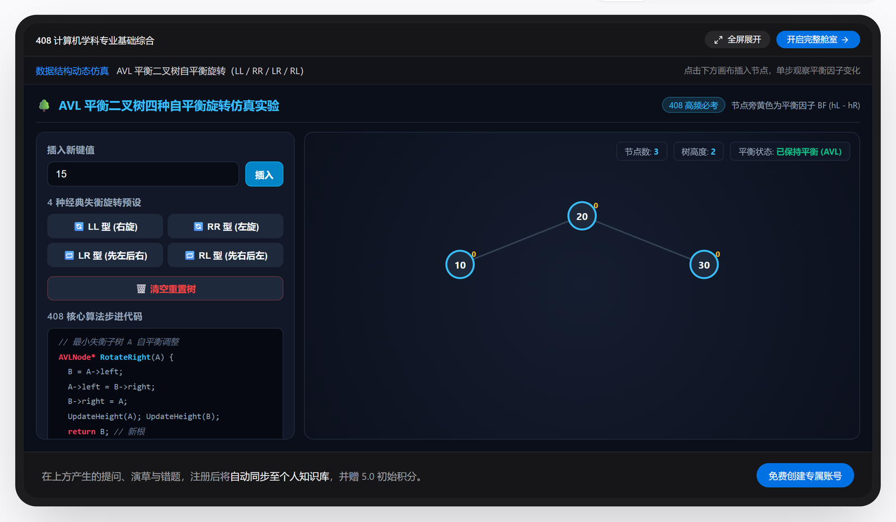
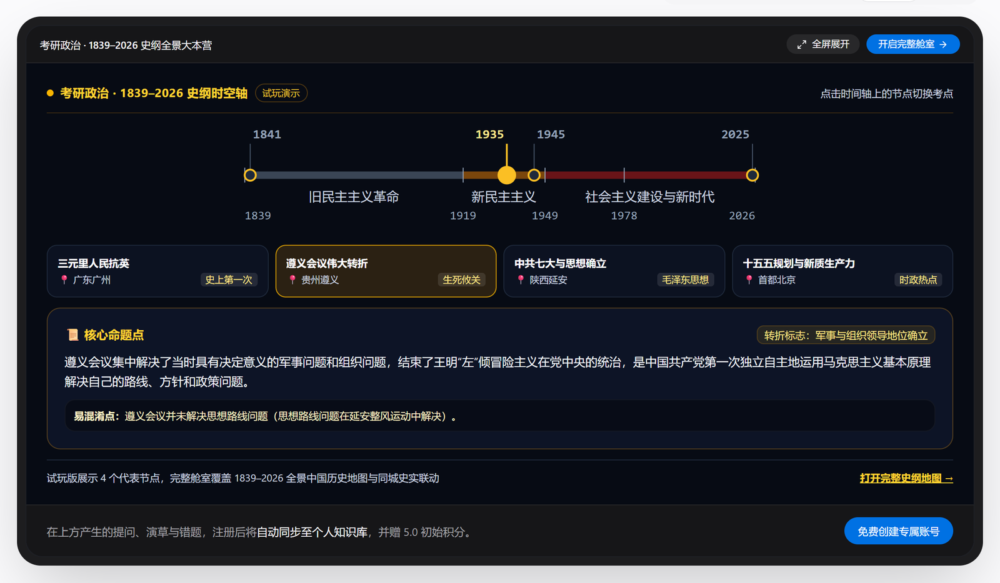
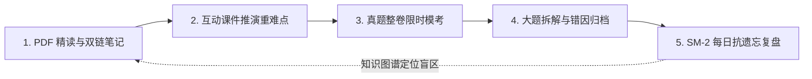
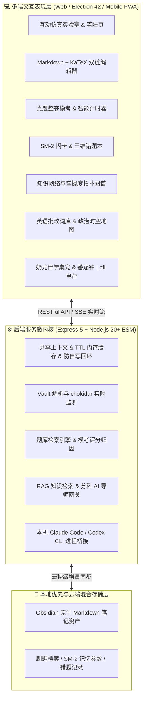

<div align="center">

<a href="https://claudexxb.online">
  
</a>

# ⚡ CoreForge 研核

### 研你所学，核力致胜 —— 面向 408 计算机与考研数学 / 英语 / 政治的全栈智能研学操作系统 & Obsidian 知识大脑

<p align="center">
  <a href="https://claudexxb.online">
    
  </a>
  <a href="https://claudexxb.online/#preview">
    
  </a>
  <a href="https://claudexxb.online/#download">
    
  </a>
  <a href="https://qts2218346424-cyber.github.io/obsidian-knowledge-viz/">
    
  </a>
</p>

<p align="center">
  <a href="https://react.dev/"></a>
  <a href="https://www.typescriptlang.org/"></a>
  <a href="https://vite.dev/"></a>
  <a href="https://expressjs.com/"></a>
  <a href="https://www.electronjs.org/"></a>
  <a href="https://katex.org/"></a>
  <a href="LICENSE"></a>
</p>

<p align="center">
  <strong>本地优先 (Local-First)</strong> ·
  <strong>历年真题整卷闭环</strong> ·
  <strong>互动仿真课件实验室</strong> ·
  <strong>分科专属 AI 导师</strong> ·
  <strong>SM-2 艾宾浩斯抗遗忘</strong> ·
  <strong>Obsidian 双链知识图谱</strong>
</p>

[🌐 线上体验官网](https://claudexxb.online) •
[🎮 动态仿真实验室](#-零门槛在线试玩五大动态仿真实验室) •
[📐 四核学科矩阵](#-四核驱动考研全科深度覆盖) •
[🧠 六大生产力底座](#-六大核心智能引擎与生产力特性) •
[📱 全平台多端覆盖](#-全平台多端无缝协同) •
[🚀 本地私有部署](#-快速开始与本地私有化部署)

---

<a href="https://claudexxb.online">
  
</a>

<p align="center">
  <sub>👆 点击上方实机预览图或直接访问 <a href="https://claudexxb.online"><strong>https://claudexxb.online</strong></a> —— 免安装、免注册，即刻动手体验 408 算法动画、高数泰勒仿真、史纲时空轴与分科 AI 导师！</sub>
</p>

</div>

---

## 🔥 为什么考研人需要 CoreForge 研核？

备战 **408 计算机综合**、**考研数学（数一 / 数二 / 数三）** 以及 **考研英语、考研政治** 是一场漫长的信息战与记忆战。传统“碎片化工具拼凑”模式往往让备考效率大打折扣，而 **CoreForge 研核** 给出了全栈一体化的终极解法：

| 备考核心痛点 | ❌ 传统碎片化工具拼凑 | ⚡ CoreForge 研核（一体化智能研学系统） |
| :--- | :--- | :--- |
| **题库与笔记割裂** | 在刷题 App 做题、在笔记软件整理，复习错题时无法定位原讲义与关联考点 | **真题与双链笔记原生打通**：手写批注、公式推导与历年真题双向链接自动沉淀，一键回溯知识源头 |
| **主观大题无人批改** | 仅支持选择题对错判定，高数证明、408 算法设计与英语大小作文难以自评踩分 | **分步拆解导师 + AI 秒级精批**：大题按踩分点逐步启发引导，英语作文提供 **20 分制四维批改**与词汇升格 |
| **抽象考点死记硬背** | 平衡树失衡旋转、泰勒高阶余项、近代史纲时空脉络全靠静态图文脑补，学完即忘 | **动态仿真课件 + SM-2 间隔记忆**：内置交互式可视实验室亲手推演，配合艾宾浩斯算法每日智能排期抗遗忘 |
| **知识资产被平台绑定** | 笔记锁死在封闭云端格式中，断网不可用、迁移成本极高 | **本地优先 + 全端云同步双模**：100% 兼容原生 Obsidian `.md` 纯文本目录，同时支持 [`claudexxb.online`](https://claudexxb.online) 在线跨设备无缝畅学 |

---

## 🎮 零门槛在线试玩：五大动态仿真实验室

无需下载客户端、无需注册登录，打开 **[claudexxb.online](https://claudexxb.online/#preview)** 即可在浏览器中直接交互推演考研高频重难点：

<table>
  <tr>
    <td width="50%" valign="top">
      <a href="https://claudexxb.online/#preview">
        
      </a>
      <h4 align="center">💻 408 数据结构 · AVL 树旋转仿真实验室</h4>
      <p>实时演示 <strong>LL / RR / LR / RL 四种失衡自平衡旋转</strong>，左侧同步高亮 C 语言核心指针变换代码与平衡因子（BF）追踪日志，彻底攻克 408 树结构高频大题。</p>
      <p align="center"><a href="https://claudexxb.online/#preview">👉 在线动手插入节点试玩 →</a></p>
    </td>
    <td width="50%" valign="top">
      <a href="https://claudexxb.online/#preview">
        
      </a>
      <h4 align="center">📐 考研数学 · 泰勒展开动态逼近实验室</h4>
      <p>自由拖动展开阶数滑块、切换目标函数，直观观测多项式曲线对真实函数的拟合过程与佩亚诺余项有效范围，秒懂求极限<strong>“首项抵消必展开、上下同阶”</strong>黄金法则。</p>
      <p align="center"><a href="https://claudexxb.online/#preview">👉 在线拖动滑块观测拟合 →</a></p>
    </td>
  </tr>
  <tr>
    <td width="50%" valign="top">
      <a href="https://claudexxb.online/#preview">
        
      </a>
      <h4 align="center">🏛️ 考研政治 · 1840–2024 史纲时空轴大本营</h4>
      <p>横跨旧民主主义革命、新民主主义革命至新时代全时段，串联高精度矢量中国地图、重大会议坐标、纲领对比（如《天朝田亩制度》对比《资政新篇》）与高频易混陷阱。</p>
      <p align="center"><a href="https://claudexxb.online/#preview">👉 在线漫游百年史纲时空 →</a></p>
    </td>
    <td width="50%" valign="top">
      <a href="https://claudexxb.online/#preview">
        
      </a>
      <h4 align="center">🤖 分科专属 AI 导师伴学中枢（双师同台）</h4>
      <p>内置 <strong>💻研小核、📐数小通、📚英小研、🏛️政小思</strong> 四位分科导师，挂载统考大纲与个人错题图谱，支持<strong>严谨推导 / 考前冲刺 / 苏格拉底追问</strong>三模切换与双师同台会诊。</p>
      <p align="center"><a href="https://claudexxb.online/#preview">👉 在线向专属导师提问 →</a></p>
    </td>
  </tr>
</table>

---

## 📐 四核驱动：考研全科深度覆盖

### 1. 💻 408 计算机学科专业基础综合
- **2009–2024 统考真题整卷库**：内置全真考场智能计时器、整卷模考判分与官方级深度解析。
- **四大核心科目全链路突破**：
  - **数据结构**：AVL 树 / 红黑树 / B+ 树动态仿真、图遍历算法、动态查找表与外部排序沙盒。
  - **计算机组成原理**：IEEE 754 浮点数编码、定点运算、Cache 组相联映射、五段流水线数据冒险与控制冒险。
  - **操作系统**：PV 信号量同步互斥经典模型、进程调度、多级页表虚拟内存地址转换、LRU / OPT 页面置换对比。
  - **计算机网络**：OSI 与 TCP/IP 协议栈、三次握手与四次挥手状态机、CIDR 子网划分与拥塞控制窗口推演。

### 2. 📐 全国考研数学（数一 / 数二 / 数三）
- **1987–2024 历年全真试卷 + 名师冲刺密押**：完整覆盖数一、数二、数三历年统考卷及李林 6 套卷、经典 1993 特训卷、概率救命班等高价值专题。
- **大题分步拆解导师 (Step Tutor)**：针对中值定理证明、多元极值、二重积分、特征值与相似对角化等核心大题，按阅卷踩分点逐步启发，告别“一看答案就会，一动笔就废”。
- **出版级 KaTeX 数学引擎**：矩阵、分段函数、多重积分与极限推导毫秒级丝滑渲染。

### 3. 📚 考研英语全题型研学中枢（英一 / 英二）
- **20 分制 AI 四维智能作文批改**：约 1.2 秒极速完成内容切题度、逻辑连贯性、语法精准度与词汇丰富度四维打分，并自动生成高分替换词升格卡片。
- **全题型精读训练**：完形填空、传统阅读理解、新题型（七选五 / 排序 / 小标题）及长难句语法树结构拆解。
- **2000+ 大纲高频词与词根词缀拓扑**：结合真题例句语境与词根衍生网络，成串记忆不孤立。

### 4. 🏛️ 考研政治百炼中枢
- **全屏史纲时空地图**：基于高精度球面墨卡托矢量中国地图，将 1840–2024 历史事件落点于空间地理坐标之上，时空联动记忆。
- **五大模块与精选题库即刷即改**：覆盖马原、毛中特、新思想、史纲、思修法基与时政，支持肖秀荣 1000 题专项突破、混淆项深度辨析与核心考点遮罩背诵卡。

---

## 🧠 六大核心智能引擎与生产力特性

- **📕 智能错题本与三维归因系统**：做错题目自动归档，按「学科 · 年份 · 考点 · 错因类型（概念混淆 / 计算失误 / 思维定势 / 审题不清）」多维聚类，支持一键抽取薄弱点生成靶向重练卷。
- **🧬 SM-2 艾宾浩斯间隔重复引擎**：从 Markdown 笔记与错题中自动提取问答闪卡，依据每次回忆质量动态计算下次复习间隔，每天清晨自动推送处于遗忘临界点的核心卡片。
- **🕸️ 知识图谱双链网络与掌握度拓扑**：可视化呈现整个 Obsidian Vault 的双向链接关系、节点掌握深度与孤立断链，一键排查知识盲区。
- **📄 PDF 讲义原卷双栏切片阅读器**：内置高精度 `PDF.js` 渲染器（完备支持 CJK 中文字体包），支持左看原卷讲义、右记双链笔记，重要定理圈选切片直入知识库。
- **🤖 云端大模型 + 本机 CLI 多 Agent 协同**：既可直连 DeepSeek、Claude、GPT 等云端模型进行知识库 RAG 问答，又可通过安全沙箱桥接本机已安装的 **Claude Code CLI** 与 **Codex CLI** 执行批处理整理任务。
- **🐲 治愈系伴学桌宠 & 沉浸式自习室**：桌面伴宠语音鼓励与抽屉式随手答疑，搭配自定义番茄钟、个人研学热力图及雨声 / 壁炉 / Lofi 学习电台，让枯燥备考时刻保持心流。

---

## 📱 全平台多端无缝协同

无论在图书馆桌面深度学习，还是在通勤路上碎片化刷卡，CoreForge 研核均提供最佳载体：

| 平台形态 | 获取与访问方式 | 核心适用场景 |
| :--- | :--- | :--- |
| 🌐 **Web 在线云端版** | 直接访问 **[https://claudexxb.online](https://claudexxb.online)** | **零安装即开即用**，跨电脑 / 平板实时同步做题进度、错题本与研学笔记 |
| 💻 **Windows 桌面客户端** | 前往 **[官网下载中心](https://claudexxb.online/#download)** 获取 64 位安装包 | 深度绑定本地 Obsidian 文件夹，支持离线阅读已下载讲义与一键本地备份导出 |
| 📲 **手机移动伴学端 (PWA)** | 手机浏览器访问 **[claudexxb.online](https://claudexxb.online)** 或扫码添加至主屏幕 | 完美适配 Android / HarmonyOS / iOS 触控交互，排队、睡前随时翻转背词与刷政治选择题 |

---

## 🗺️ 考研冲刺五步全闭环最佳实践



---

## 🏗️ 系统分层全景架构



---

## 🚀 快速开始与本地私有化部署

如果你希望在本地连接自己的 Obsidian 知识库运行或进行二次开发，只需 3 分钟即可启动完整全栈环境：

### 1. 环境要求
- **Node.js**：`v20.0.0` 及以上版本
- **操作系统**：Windows 10/11、macOS 或 Linux

### 2. 克隆仓库与安装依赖
```bash
git clone https://github.com/qts2218346424-cyber/obsidian-knowledge-viz.git
cd obsidian-knowledge-viz
npm install
```

### 3. 初始化本地配置
```bash
# Windows (PowerShell / CMD)
copy server\config.example.json server\config.json

# macOS / Linux
cp server/config.example.json server/config.json
```

按需编辑 `server/config.json`（已纳入 `.gitignore` 保护，不会泄露密钥）：
```json
{
  "vaultPath": "C:\\Users\\YourName\\Documents\\ObsidianVault",
  "port": 3001,
  "host": "127.0.0.1",
  "ai": {
    "provider": "openai-compatible",
    "baseURL": "https://api.deepseek.com/v1",
    "apiKey": "your-api-key",
    "model": "deepseek-chat"
  },
  "localAgents": {
    "claudeCommand": "claude",
    "codexCommand": "codex"
  }
}
```

### 4. 一键启动前后端工作台
```bash
# 并行启动前端 Vite 热更新服务 (:5173) 与后端 Express 微内核 (:3001)
npm run dev:all
```
打开浏览器访问 **`http://localhost:5173`**，或直接访问线上官方云端站 **[https://claudexxb.online](https://claudexxb.online)** 立即开启高效备考！

### 5. 打包桌面端安装包（可选）
```bash
# 全量构建前后端并打包生成 Electron 桌面客户端 (.exe)
npm run build:all
npm run pack
```

---

## 🛠️ 常用工程脚本速查

| 命令 | 功能说明 |
| :--- | :--- |
| `npm run dev:all` | **(推荐)** 同时启动前端开发服务器 (`:5173`) 与后端 API 服务 (`:3001`) |
| `npm run dev` | 单独启动前端 Vite 开发服务 |
| `npm run server:dev` | 单独启动后端 Express 服务并监听源码变更 |
| `npm run build:all` | 执行 TypeScript 类型校验并完成前后端生产级构建 |
| `npm run pack` | 基于 Electron Builder 打包桌面端独立安装包（输出至 `release/`） |

---

## 🤝 参与共建与支持我们

CoreForge 研核致力于用工程与认知科学的力量，陪伴每一位考研人走过最孤独也最滚烫的冲刺岁月。

- 🌟 **点亮 Star 支持**：如果这个项目或 **[claudexxb.online](https://claudexxb.online)** 对你的复习有所帮助，请点击右上角 **Star** 支持我们，并分享给身边的研友！
- 🐛 **问题反馈与建议**：欢迎通过 [GitHub Issues](https://github.com/qts2218346424-cyber/obsidian-knowledge-viz/issues) 提交 Bug 报告、真题勘误或新学科特性建议。
- 🔀 **代码贡献**：欢迎提交 Pull Request，共同打磨更强大的开源研学工具链。

---

## 📄 开源协议

本项目基于 [MIT License](LICENSE) 协议开源，个人学习、考研自习互助及高校非商业学术使用完全自由。

<div align="center">

<br />

**[🌐 立即访问 claudexxb.online 开启研学](https://claudexxb.online)** · **[🎮 免登录试玩实验室](https://claudexxb.online/#preview)** · **[🎬 实机互动展厅](https://qts2218346424-cyber.github.io/obsidian-knowledge-viz/)**

**祝每一位并肩作战的考研人：研你所学，核力致胜，一战成硕，顶峰相见！🎓✨**

</div>
