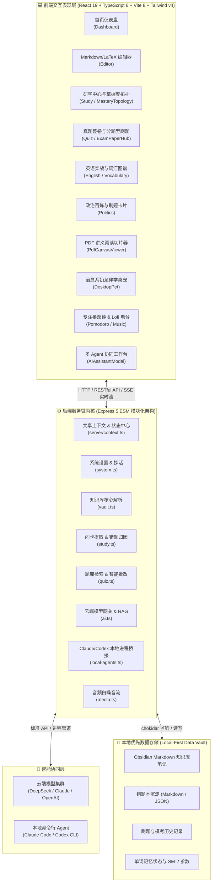
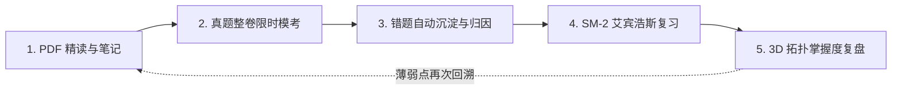

<div align="center">

# ⚡ CoreForge 研核 · Obsidian Kaoyan Next

### 面向 408 计算机与考研数学/英语/政治的一体化全栈智能研学操作系统 & Obsidian 知识大脑

[](https://react.dev/)
[](https://www.typescriptlang.org/)
[](https://vite.dev/)
[](https://expressjs.com/)
[](https://www.electronjs.org/)
[](https://katex.org/)
[](LICENSE)
[](https://github.com/qts2218346424-cyber/obsidian-knowledge-viz/releases)

<p align="center">
  <strong>本地优先 (Local-First)</strong> · 
  <strong>真题整卷全闭环</strong> · 
  <strong>大题分步拆解导师</strong> · 
  <strong>SM-2 艾宾浩斯复习</strong> · 
  <strong>多 Agent 本地桥接</strong> · 
  <strong>治愈系伴学桌宠</strong>
</p>

[✨ 核心功能亮点](#-核心功能亮点) •
[📐 四大学科矩阵](#-四大学科超级功能矩阵) •
[🤖 多 Agent 协同体系](#-本地--云端多-agent-协同体系) •
[🚀 快速上手](#-快速开始与本地运行) •
[🏗️ 系统架构图解](#-系统分层全景架构) •
[🗺️ 备考最佳实践](#-考研冲刺全闭环最佳实践)

---

</div>

## 💡 为什么诞生 CoreForge 研核？

在备考 **408 计算机综合**、**考研数学（数一/数二/数三）** 以及 **考研英语与政治** 的过程中，几乎所有考研人都会遇到以下致命痛点：

1. **刷题工具与笔记割裂**：在各大题库刷题，题目与笔记分离在不同软件中，复习错题时无法直接跳转回自己的知识体系。
2. **大题与公式难以自我批改**：主流刷题软件仅支持选择题对错判定，面对数学证明、概率推导、408 算法设计等解答大题，无法提供「踩分点逐级拆解」与智能辅导。
3. **学完就忘，缺乏科学复盘机制**：笔记越记越多却很少回顾，缺乏符合艾宾浩斯记忆遗忘规律的科学闪卡调度。
4. **数据被云端平台垄断与绑定**：笔记和进度随时可能因服务器故障或平台规则受限，无法真正沉淀为属于自己的本地知识资产。

**CoreForge 研核** 为此而生。它深度打通用户的 **本地 Obsidian Vault**，将 **Markdown 笔记系统**、**历年统考真题库**、**LaTeX 解题引擎**、**SM-2 间隔记忆**、**3D 知识拓扑图谱**、**PDF 讲义阅读器**、**多 Agent AI 辅助** 与 **治愈系伴学桌面宠物** 融为一体，打造考研人终身受用的终极研学工作台！

---

## ✨ 核心功能亮点

```
                            CoreForge 研核 智能中枢
                 ┌───────────────────┴───────────────────┐
                 ▼                                       ▼
       【工科/计算机核心两门】                         【考研公共课核心两门】
       ├─ 408 计算机学科基础综合                     ├─ 全国硕士考研英语 (一 / 二)
       │  (数据结构 / 计组 / 操作系统 / 计网)          │  (完型 / 阅读 / 新题型 / 翻译 / 全套卷)
       └─ 全国硕士考研数学 (数一/数二/数三)            └─ 全国硕士思想政治理论
          (高等数学 / 线性代数 / 概率论)                 (马原 / 毛中特 / 史纲 / 思修 / 时政)
                 │                                       │
                 └───────────────────┬───────────────────┘
                                     ▼
                      ┌─────────────────────────────┐
                      │    一体化研学能力矩阵与底座   │
                      ├─────────────────────────────┤
                      │ 📝 沉浸式知识编辑 (KaTeX/双链)│
                      │ 🧠 艾宾浩斯 SM-2 算法间隔记忆│
                      │ 📋 历年真题整卷库与专项模拟卷│
                      │ 🎯 错题本三维归因与分步踩分核对│
                      │ 🐲 奶龙桌面伴学宠物与语音交互│
                      │ 🤖 多 Agent (Claude/Codex/Web)│
                      │ 📄 PDF 讲义圈选切片阅读器   │
                      │ 🎵 专注番茄钟与 Lofi 沉浸电台 │
                      └─────────────────────────────┘
```

---

## 📐 四大学科超级功能矩阵

### 1. 考研数学专区 (数一 / 数二 / 数三)
* **历年全真试卷库**：收录 1987~2024 年考研数学真题整卷，涵盖数一、数二、数三完整卷面与标准解答。
* **名师模拟卷与特色密押**：包含李林6套卷、经典1993特训卷、救命班重点专项等高频冲刺卷。
* **大题分步拆解导师 (Step Tutor)**：针对极限证明、多元微分极值、二重积分、特征值与对角化等解答大题，提供分步踩分点核对与逐步启发式引导。
* **高保真 LaTeX 公式渲染**：原生集成 KaTeX 引擎，所有分式、矩阵、根号、积分与分段函数均呈现出版级印刷排版。

### 2. 408 计算机学科专业基础综合
* **四合一统考真题整卷库**：完整收录 2009~2024 年全国硕士统考 408 试题与官方权威解析。
* **分科专题攻克**：
  * **数据结构**：树与二叉树、图算法遍历、动态查找表、排序算法沙盒演练。
  * **计算机组成原理**：浮点数编码、定点乘除、指令系统格式、Cache 组相联映射与流水线冒险。
  * **操作系统**：PV 信号量同步互斥、进程调度算法、两级分页虚拟存储、页面置换算法。
  * **计算机网络**：TCP 三次握手/四次挥手、IP 子网掩码划分、拥塞控制窗口滑动机制。

### 3. 考研英语实战中心 (英语一 / 英语二)
* **全真套卷与分题型专项突破**：
  * **完形填空 (Cloze)**：历年篇章精读与生词选项速查。
  * **传统阅读 (Reading Comprehension)**：主旨题、细节题、推断题与态度题精析。
  * **新题型 (New Type)**：七选五、排序题、小标题匹配全真模拟。
  * **英汉互译 (Translation)**：长难句语法结构拆分与标准参考译文。
* **考研大纲核心词汇与词根词缀图谱**：高频词汇翻转闪卡记忆、词根词缀衍生拓扑与真题例句索引。

### 4. 考研政治百炼中枢
* **五大核心模块全面覆盖**：马克思主义基本原理、毛泽东思想和中国特色社会主义理论体系概论、中国近现代史纲要、思想道德与法治、形势与政策。
* **客观选择题专项训练**：单选与多选题即做即改，混淆选项深度辨析。
* **必背核心知识点卡片**：高频大题答题框架、核心考点艾宾浩斯复习卡，助你临考冲刺速记提分。

---

## 🧠 核心智能引擎与生产力特性

### 📕 智能错题本与三维归因系统
- **自动归档**：做错题目自动录入系统，完整记录你的历史作答、正确推导及做题用时。
- **三维标签聚类**：支持按学科、按年份、按考点、按错因类型（概念混淆 / 计算失误 / 思维定势 / 审题不清）多维筛选。
- **一键发起定向重练**：选定薄弱专题或历史错题，秒级自动拼装为全新靶向突破练习卷。

### 🐲 奶龙治愈系桌面伴学宠物
- **生动交互**：基于自主研发的骨骼动画组件与生动表情，陪伴在屏幕一隅。
- **真人配音与语音激励**：内置多段专属鼓励配音，缓解考研焦虑与备考疲劳。
- **抽屉式即时答疑**：点击伴宠即可无缝滑出学习助手抽屉，随时向 AI 导师提问答疑。

### 📄 PDF 讲义与真题原卷高保真精读
- **双栏对照阅读**：内嵌 PDF.js 高精度渲染引擎（支持 CJK 中文字体包），原卷与笔记左右对照。
- **笔记切片与知识点提取**：一键截取圈划重要公式定理，直接导入 Obsidian 笔记形成永久双链。

### 🕸️ 知识图谱三维/二维双链网络拓扑
- **可视化掌握度**：通过不同颜色与节点尺寸直观展示笔记掌握深度与复习频次。
- **断链排查与知识梳理**：自动扫描孤立笔记、无效外链并一键修复。

### 🎵 沉浸式备考自习室
- **专注番茄钟**：自定义备考周期、阶段休息提醒与自习统计。
- **白噪音与 Lofi 电台**：精选雨声、林涛、壁炉声与学习 Lofi 音乐流，戴上耳机即刻进入心流状态。
- **每日备考打卡**：记录坚持天数与累计刷题量，生成个人专属研学热力图。

---

## 🤖 本地 / 云端多 Agent 协同体系

CoreForge 研核突破性地将**本地开发型 Agent**与**云端智能大模型**深度融合：

```
                    ┌─────────────────────────┐
                    │  CoreForge AI 工作中枢   │
                    └────────────┬────────────┘
         ┌───────────────────────┼───────────────────────┐
         ▼                       ▼                       ▼
【云端智能大模型】      【本机 Claude Code CLI】   【本机 Codex CLI】
├─ DeepSeek V3 / R1     ├─ 本地项目上下文读取    ├─ 代码片段与工程重构
├─ Claude 3.5 Sonnet    ├─ 本机目录安全沙箱      ├─ 知识库批量脚本自动化
└─ OpenAI GPT-4o        └─ 实时 SSE 流式输出     └─ 跨会话状态记忆续接
```

* **网页 AI 工作台**：支持主流云端大语言模型直连，提供知识库检索增强 (RAG) 问答、思维导图自动生成。
* **本地 Claude Code & Codex 桥接**：直接调度宿主机本地已安装的 Claude Code / Codex 命令行环境，安全在指定工作目录运行批处理与高级分析任务。

---

## 🏗️ 系统分层全景架构



---

## 🚀 快速开始与本地运行

### 1. 环境准备
* **Node.js**：v20.0.0 或更高版本
* **包管理器**：npm / pnpm / yarn
* **操作系统**：Windows 10/11、macOS、Linux

### 2. 获取代码与安装依赖
```bash
# 克隆仓库
git clone https://github.com/qts2218346424-cyber/obsidian-knowledge-viz.git
cd obsidian-knowledge-viz

# 安装前端与后端依赖
npm install
```

### 3. 配置服务环境
复制本地配置模板：
```bash
# Windows
copy server\config.example.json server\config.json

# macOS / Linux
cp server/config.example.json server/config.json
```

编辑 `server/config.json` 填写你的本地配置（已加入 `.gitignore`，安全不泄露）：
```json
{
  "vaultPath": "C:\\Users\\YourName\\Documents\\ObsidianVault",
  "port": 3001,
  "host": "127.0.0.1",
  "ai": {
    "provider": "openai-compatible",
    "baseURL": "https://api.deepseek.com/v1",
    "apiKey": "your-api-key",
    "model": "deepseek-chat"
  },
  "localAgents": {
    "claudeCommand": "claude",
    "codexCommand": "codex"
  }
}
```

### 4. 启动研学工作台
```bash
# 同时启动前端 (5173) 与 后端 (3001) 开发服务
npm run dev:all
```
浏览器打开：**`http://localhost:5173`** 即可开启你的考研高效备战之旅！

---

## 📦 打包桌面端 (Electron)

CoreForge 支持一键打包为跨平台桌面客户端：

```bash
# 前后端全量构建验证
npm run build:all

# 构建并打包 Windows 可执行安装包 (.exe)
npm run pack
```
打包输出目录位于 `release/`，生成绿色免安装版本与完整安装程序。

---

## 🗺️ 考研冲刺全闭环最佳实践

为了发挥 CoreForge 研核的最大效能，推荐以下五步闭环法：



1. **第一步：看书与精读讲义**：在 PDF 阅读器中阅读教材与讲义，圈划关键定理切片录入 Obsidian 笔记。
2. **第二步：真题整卷限时模考**：进入做题中心选择数学、408、英语或政治真题整卷，全真模拟考场环境。
3. **第三步：大题拆解与错题沉淀**：作答完毕一键交卷，大题通过 Step Tutor 核对踩分点，错题一键沉淀并打上归因标签。
4. **第四步：每日艾宾浩斯翻转复习**：每天清晨唤醒研学中心，系统自动基于 SM-2 算法推选出当天遗忘临界点的错题与知识闪卡。
5. **第五步：知识图谱宏观复盘**：定期在掌握度拓扑图中巡检知识盲区，针对薄弱节点精准回溯强化。

---

## 🛠️ 常用开发脚本字典

| 脚本命令 | 说明 |
| :--- | :--- |
| `npm run dev` | 单独启动前端 Vite 极速开发热更新服务 (`:5173`) |
| `npm run server:dev` | 单独启动后端 Express API 服务并监听文件改动 (`:3001`) |
| `npm run dev:all` | **(推荐)** 并行启动前端与后端开发服务 |
| `npm run build` | 执行 TypeScript 类型检查与前端 Vite 生产构建 |
| `npm run build:server` | 使用 esbuild 进行后端模块极速打包 |
| `npm run build:all` | 生产发布前全量构建前后端 |
| `npm run pack` | 打包生成 Electron 桌面端生产安装包 |

---

## 🤝 参与贡献与社区

欢迎所有备战考研、热爱知识工程与开源工具的小伙伴共同建设 CoreForge 研核！

- 🐛 **提交 Bug**：在 [GitHub Issues](https://github.com/qts2218346424-cyber/obsidian-knowledge-viz/issues) 中详细描述遇到的问题与复现步骤。
- 💡 **功能建议**：如果你有关于考研备考、题库补充、新题型交互的绝妙点子，欢迎发起 Issue 或 Discussion。
- 🔀 **Pull Request**：
  1. Fork 本仓库并新建分支 (`feature/your-awesome-feature`)
  2. 提交清晰的代码变更并确保 `npm run build:all` 顺利通过
  3. 提交 PR 并附带说明，我们将第一时间 review 并合并！

---

## 📄 开源许可证

本项目基于 [MIT License](LICENSE) 开源协议，个人、高校备考团队及非商业学习使用完全自由。

<div align="center">

**祝所有使用 CoreForge 研核的考研学子：一战成硕，金榜题名！🎓**

</div>
