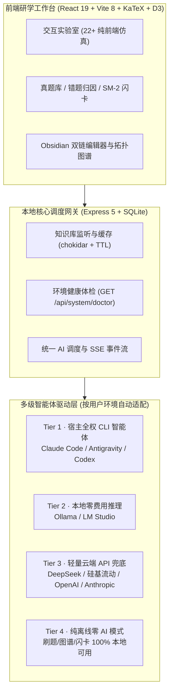

# CoreForge 研核 · 开源通用架构与多用户复刻指南

本文档面向所有克隆、二次开发或私有化部署 **CoreForge 研核** 的开发者与用户，阐述如何将这套 **“本地优先知识大脑 + 宿主超级智能体（Claude Code / Antigravity）”** 架构无缝复刻到任意一台 Windows / macOS / Linux 电脑上。

---

## 1. 核心架构理念：三层解耦与优雅降级

CoreForge 采用 **前后端同构 + 本地优先（Local-First）+ 多级智能体适配** 架构，确保无论用户的电脑配置高低，都能开箱即用：



---

## 2. 任意用户 3 分钟复刻指南（零门槛启动）

### 第一步：克隆与一键初始化
```bash
git clone https://github.com/qts2218346424-cyber/obsidian-knowledge-viz.git
cd obsidian-knowledge-viz
npm install
npm run setup
```
`npm run setup` 会安全生成初始的 `server/config.json`（若已存在则绝不覆盖），并自动调用 `npm run doctor` 对你的本机环境进行全项体检。

### 第二步：按需选择你的 AI 动力源（三选一，可随时切换）

1. **极客满血模式（推荐 · 与作者完全一致的体验）**：
   - 安装并登录 Claude Code：`npm install -g @anthropic-ai/claude-code && claude login`
   - 或安装 Google Antigravity 桌面端 / `agy` CLI
   - 启动 CoreForge 后，后端 `local-agent-bridge.ts` 会自动发现你本机的 CLI 可执行文件，直接赋予 AI 深度伴读、检索与重构你本地 Obsidian 知识库的能力。
2. **小白普惠云端模式（无显卡要求）**：
   - 复制 `.env.example` 为 `.env`，填入 DeepSeek / 硅基流动 / OpenAI 兼容的 `COREFORGE_AI_API_KEY`；
   - 或启动后直接在软件右上角【设置】页可视化填入。
3. **离线零成本模式**：
   - 启动本地 [Ollama](https://ollama.com)（默认端口 `11434`），软件自动探测列出本地模型；
   - 或者完全不配 AI，直接离线使用真题库、算法实验室、SM-2 闪卡和笔记图谱。

### 第三步：启动体验
```bash
# Web 浏览器双核模式 (前端 5173 + 后端 3001)
npm run dev:all

# Electron 桌面客户端模式
npm run electron:dev
```

---

## 3. 安全隔离与零隐私泄露原则

- **个人配置永不入库**：`server/config.json`、`.env`、`data/`、`uploads/` 均已严格纳入 `.gitignore`，你可以放心 Fork 或提交 PR，绝不会泄露自己的 API Key、本机路径或学习笔记。
- **支持双轨部署（官网前店 + 开源后厂）**：
  - 静态前端可通过 `npm run build` 一键部署至 **Cloudflare Pages / Vercel** 作为在线体验展厅；
  - 桌面端通过 `.github/workflows/release.yml` 在推送 `v*` 标签时全自动在云端编译并发布安装包至 GitHub Releases。
